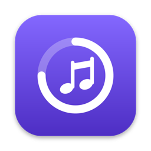
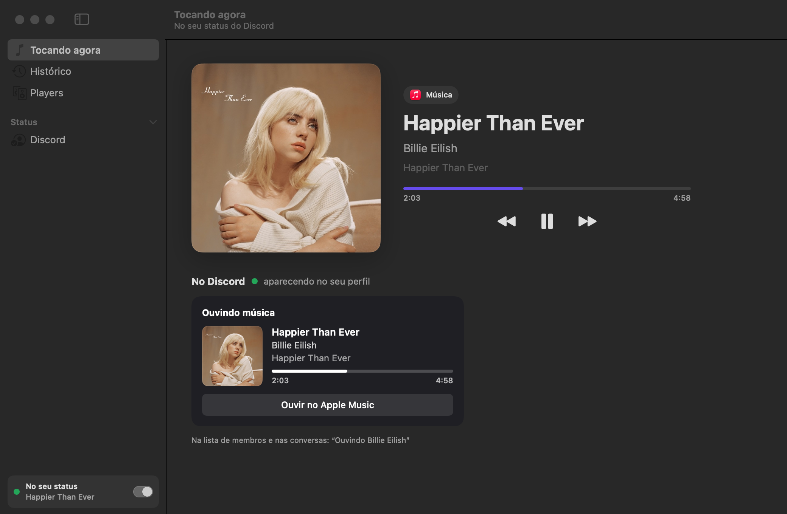
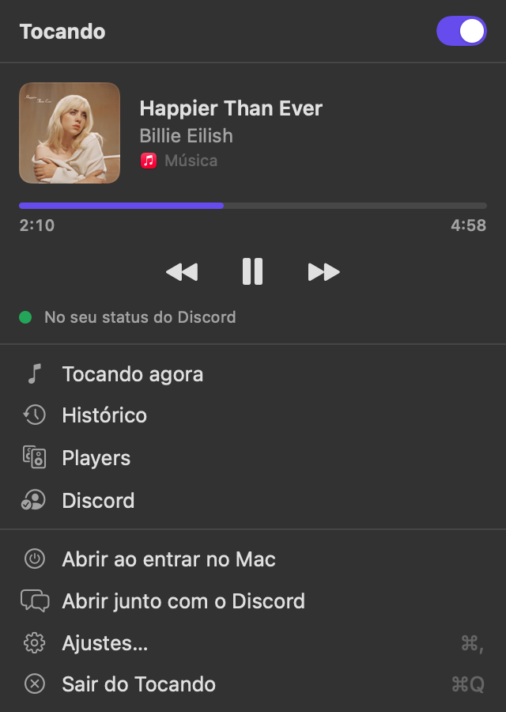
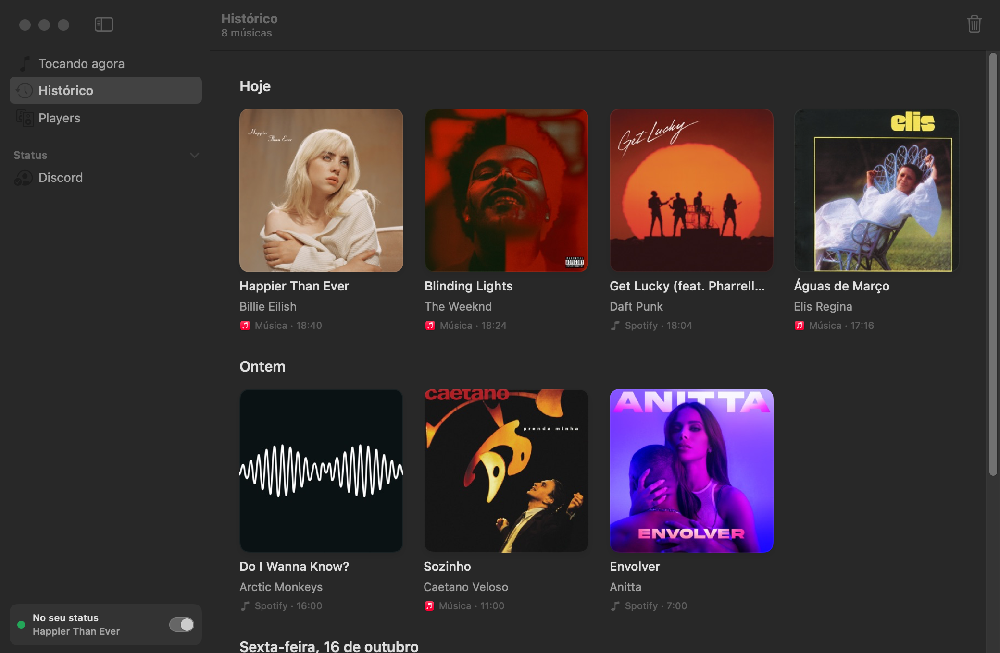
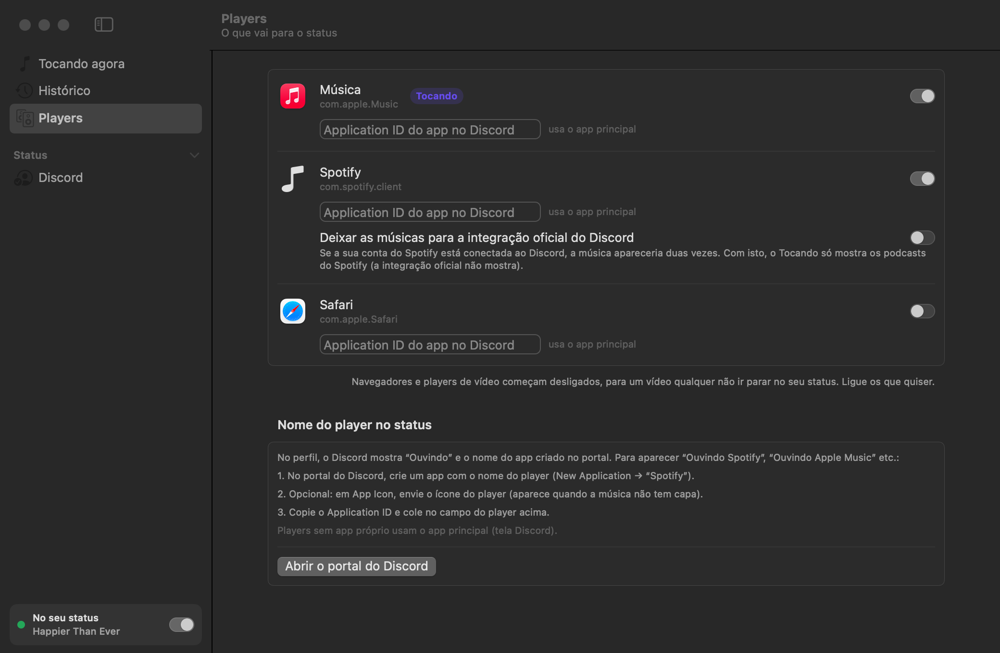
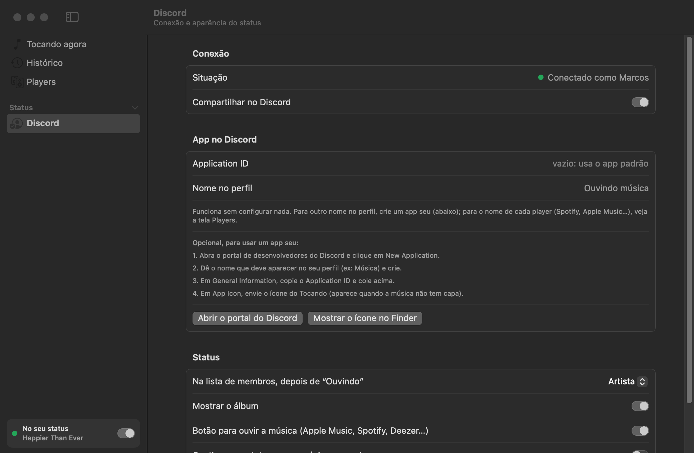

<p align="center">
  
</p>

<h1 align="center">Tocando</h1>

<p align="center">
  Mostra no seu status do Discord a música que está tocando no Mac.<br>
  Qualquer player. Fica quietinho na barra de menus.
</p>

<p align="center">
  <a href="https://github.com/marcosznl/tocando/releases/latest"><b>⬇︎ Baixar o DMG</b></a>
  &nbsp;·&nbsp; macOS 14 ou mais novo &nbsp;·&nbsp; Apple Silicon e Intel &nbsp;·&nbsp; 1,7 MB
</p>

<p align="center">
  
</p>

---

## Índice

- [O que ele faz](#o-que-ele-faz)
- [Instalação](#instalação)
- [Primeiros passos](#primeiros-passos)
- [Usando o app](#usando-o-app)
- [Players](#players)
- [O status no Discord](#o-status-no-discord)
- [Abrir sozinho](#abrir-sozinho)
- [Permissões e privacidade](#permissões-e-privacidade)
- [Problemas comuns](#problemas-comuns)
- [Desinstalar](#desinstalar)
- [Compilar a partir do código](#compilar-a-partir-do-código)
- [Como funciona por dentro](#como-funciona-por-dentro)
- [Licenças](#licenças)

---

## O que ele faz

O Tocando lê o "Tocando agora" do macOS, o mesmo da Central de Controle, e coloca a
música no seu perfil do Discord como uma atividade **"Ouvindo"**:

- **Qualquer player**: Música, Spotify, TIDAL, Deezer, Amazon Music, Podcasts, VLC, IINA, players
  feitos em casa… Se aparece na Central de Controle, ele vê.
- **Cartão completo**: capa do álbum, música, artista, álbum, **barra de progresso** em tempo real
  e um botão **"Ouvir no Spotify / Deezer / TIDAL / Apple Music"**, conforme o player.
- **A música tem prioridade**: abriu um vídeo no Safari? O macOS passa o "Tocando agora" para o
  navegador, mas o Tocando continua mostrando a música enquanto ela tocar.
- **Segundo plano de verdade**: não aparece no Dock nem no ⌘Tab, só como um ícone na barra de
  menus. Usa uns 48 MB de memória e quase nada de processador.
- **Funciona sem configurar nada**: já vem com um app do Discord pronto. Se quiser, você usa o
  seu, ou um para cada player ("Ouvindo Spotify", "Ouvindo Apple Music"…).
- **Histórico**: todas as músicas que tocaram, por dia, com capa e player.
- **Leve e nativo**: SwiftUI, sem Electron e sem bibliotecas de terceiros (só um adaptador
  pequeno para ler o "Tocando agora"). O app inteiro tem 3,8 MB.

## Instalação

1. Baixe o **`Tocando.dmg`** na [página de releases](https://github.com/marcosznl/tocando/releases/latest).
2. Abra o DMG e arraste o **Tocando** para a pasta **Aplicativos**.
3. Abra o app pela pasta Aplicativos (ou pelo Spotlight).

**Na primeira vez o macOS vai reclamar.** O app não é assinado com uma conta paga de
desenvolvedor da Apple, então aparece "O Apple não conseguiu verificar…". Para liberar:

- Abra **Ajustes do Sistema → Privacidade e Segurança**, role até o aviso sobre o Tocando
  e clique em **Abrir Mesmo Assim**. Confirme com a sua senha.
- Ou, no Terminal, tire a marca de quarentena e abra de novo:

  ```bash
  xattr -dr com.apple.quarantine /Applications/Tocando.app
  ```

Isso só é preciso uma vez.

**Requisitos**

- macOS 14 (Sonoma) ou mais novo, em Mac com Apple Silicon ou Intel.
- O **app do Discord para desktop** aberto no mesmo Mac. O Discord no navegador não aceita
  atividades de outros apps.

## Primeiros passos

1. Abra o Tocando. Na primeira vez ele mostra a janela principal; depois, fica só no ícone
   da barra de menus.
2. Abra o Discord (o app) e dê play em qualquer música.
3. Pronto: em poucos segundos a música aparece no seu perfil.

O ícone na barra de menus mostra a situação:

| Ícone | Significa |
|:---:|---|
| ♪ nota | a música está no seu status do Discord |
| ❙❙ pausa | tocando, mas fora do status (pausado, player desligado ou Discord fechado) |
| alto-falante riscado | compartilhamento desligado |

## Usando o app

### O painel do ícone

Clique no ícone da barra de menus:

<p align="center">
  
</p>

- O **interruptor** no topo liga e desliga o compartilhamento (também com **⌘D** com a janela aberta).
- A música, com capa, progresso e os controles **anterior / tocar-pausar / próxima**, que
  funcionam no player que estiver tocando.
- Atalhos para as telas: **Tocando agora**, **Histórico**, **Players** e **Discord**.
- **Abrir ao entrar no Mac**, **Abrir junto com o Discord**, **Ajustes** e **Sair**.

### Tocando agora

A música atual em destaque e, embaixo, a **prévia do cartão** como ele aparece no seu perfil do
Discord, com a linha curta que aparece na lista de membros. Se a música não estiver no status, a
tela diz por quê (pausada, player desligado, Discord fechado…).

### Histórico

<p align="center">
  
</p>

As músicas que tocaram, em grade, separadas por dia, com a capa, o artista, o player e a hora.
Clique duplo abre a música no Apple Music; o clique direito copia "Artista — Música" ou remove do
histórico. A lixeira no canto limpa tudo. Guarda as últimas 300 músicas.

## Players

<p align="center">
  
</p>

Cada player que já tocou alguma coisa aparece aqui, com um interruptor para decidir se vai para
o status.

- **Navegadores e players de vídeo começam desligados** (Safari, Chrome, Firefox, Arc, Edge,
  Brave, VLC, IINA, mpv, TV, QuickTime), para um vídeo qualquer não ir parar no seu status. Ligue
  os que quiser.
- **A música tem prioridade sobre vídeos.** O macOS só informa um "Tocando agora": o do app que
  começou a tocar por último. Quando um navegador ou player de vídeo toma esse lugar, o Music
  Presence continua com a música que estava tocando:
  - no **Música** e no **Spotify**, ele pergunta ao próprio app (AppleScript) se a música ainda
    toca, qual é e em que ponto está;
  - nos outros, mantém a música até ela acabar, pelo tempo dela.

  O vídeo só aparece quando não há música tocando, e se o player dele estiver ligado.
- **Spotify conectado ao Discord**: se a sua conta do Spotify está ligada ao Discord, a
  integração oficial já mostra as músicas e elas apareceriam duas vezes. Ligue **"Deixar as
  músicas para a integração oficial"** na linha do Spotify: o Tocando passa a mostrar só os
  podcasts do Spotify, que a integração oficial não mostra.
- **App do Discord por player**: veja [Nome do player no status](#nome-do-player-no-status).

## O status no Discord

<p align="center">
  
</p>

### O que aparece

- **No perfil** (o cartão): "Ouvindo *nome do app*", a capa, a música, o artista, o álbum, a barra
  de progresso e o botão.
- **Na lista de membros e nas conversas** (a linha curta): você escolhe o que vem depois de
  "Ouvindo": o **artista**, a **música** ou o **nome do app**.

Na tela **Discord** você também liga ou desliga o álbum, o botão e se a música **continua no
status quando pausada**.

### Capas

O Discord só mostra imagens que estão na internet, e a capa que o player manda fica só no seu
Mac. Por isso o Tocando procura a mesma música, nesta ordem, no catálogo da Apple, no
Deezer e no MusicBrainz + Cover Art Archive. Uma música que não está em nenhum deles (arquivo
próprio, gravação caseira) aparece com o ícone do app do Discord.

### O botão

O botão abre a música no serviço do player que está tocando:

| Player | Botão | Link |
|---|---|---|
| Spotify | Ouvir no Spotify | a faixa exata, lida do próprio Spotify (ou uma busca, sem a permissão de Automação) |
| Deezer | Ouvir no Deezer | a faixa no Deezer |
| TIDAL | Ouvir no TIDAL | busca no TIDAL |
| Amazon Music | Ouvir no Amazon Music | busca no Amazon Music |
| Música e os outros | Ouvir no Apple Music | a faixa no catálogo da Apple |

O botão aparece para os outros, não para você: o Discord não mostra botões das suas próprias
atividades.

### O app no Discord

O Discord só mostra atividades de "apps" cadastrados no portal de desenvolvedores, e o nome desse
app é o que aparece em "Ouvindo …" no perfil. O Tocando já vem com um **app padrão**, então
não precisa configurar nada.

Para usar um nome seu:

1. Abra o [portal de desenvolvedores do Discord](https://discord.com/developers/applications) e
   clique em **New Application**.
2. Dê o nome que deve aparecer no perfil (ex: "Música") e crie.
3. Em **General Information**, copie o **Application ID** e cole na tela **Discord** do app.
4. Em **App Icon**, envie um ícone: ele aparece quando a música não tem capa. O botão "Mostrar o
   ícone no Finder" acha o ícone do Tocando.

Apagar o campo volta para o app padrão.

### Nome do player no status

Para aparecer "Ouvindo Spotify", "Ouvindo Apple Music" etc., crie no portal um app para cada
player, com o nome dele (de preferência com o ícone dele), e cole o Application ID no campo do
player na tela **Players**. O Tocando troca de app sozinho conforme o player que está
tocando. Players sem app próprio usam o principal.

## Abrir sozinho

No painel do ícone ou em **Ajustes → Geral**:

| Opção | Como funciona |
|---|---|
| Não | só abre quando você abre |
| Ao entrar no Mac | abre com o Mac, já no ícone da barra de menus |
| **Junto com o Discord** | abre com o Mac, mas fica **dormindo** (sem ícone, sem ler a música, uns 35 MB) enquanto o Discord estiver fechado, e acorda quando ele abre |

O macOS não tem como abrir um app quando outro abre; por isso o modo "junto com o Discord"
funciona dormindo. Para abrir a janela com o app dormindo, abra o Tocando pelo Finder ou
pelo Spotlight.

Também dá para mudar pelo Terminal:

```bash
/Applications/Tocando.app/Contents/MacOS/Tocando --launch-mode discord   # manual | login | discord
```

## Permissões e privacidade

**Permissões que o macOS pode pedir**

- **Automação → Música / Spotify**: só quando um vídeo toma o lugar da música (para saber se ela
  ainda toca) e para pegar o link exato da faixa no Spotify. Sem ela, o app usa os planos B
  descritos acima. Para mudar depois: **Ajustes do Sistema → Privacidade e Segurança → Automação**.
- **Itens de início**: quando você liga "Abrir ao entrar no Mac" ou "Junto com o Discord".

Não pede gravação de tela, acessibilidade, microfone nem acesso a arquivos.

**O que sai do seu Mac**

| Para onde | O quê | Por quê |
|---|---|---|
| App do Discord (no próprio Mac) | a atividade (música, artista, álbum, capa, tempo) | é o status |
| `itunes.apple.com`, `api.deezer.com`, `musicbrainz.org`, `coverartarchive.org` | título, artista e álbum | achar a capa e o link |
| `discord.com/api/…/applications/<id>/rpc` | o Application ID | mostrar o nome do app no Discord |

Sem contas, sem login, sem estatísticas de uso e sem servidor próprio.

**O que fica no seu Mac**

- Ajustes: `~/Library/Preferences/com.marcos.tocando.plist`
- Histórico e miniaturas das capas: `~/Library/Application Support/Tocando/`

## Problemas comuns

**A música não aparece no meu perfil**

1. O **app do Discord** precisa estar aberto (no navegador não funciona).
2. No Discord, **Configurações de usuário → Privacidade de atividades**: deixe ligada a opção de
   compartilhar a sua atividade detectada.
3. Veja a tela **Tocando agora** do app: a seção "No Discord" diz por que a música
   está fora do status (pausada, player desligado em Players, Discord fechado…).
4. O player está ligado na tela **Players**? Navegadores começam desligados.

**A música aparece sem capa**

Ela não está no catálogo da Apple, no Deezer nem no MusicBrainz. Envie um ícone ao app do
Discord (veja [O app no Discord](#o-app-no-discord)) para não ficar sem imagem.

**O player não é detectado**

O Tocando vê o mesmo que a Central de Controle. Se a música não aparece lá, o player não
está informando o macOS; alguns precisam de uma opção ou extensão para isso.

**Atualizei o macOS e parou de ler a música**

A leitura do "Tocando agora" usa um caminho que a Apple pode mudar. Abra uma issue no repositório.

**Duas músicas no perfil com o Spotify**

É a integração oficial do Spotify mais o Tocando: ligue "Deixar as músicas para a
integração oficial" na linha do Spotify, em **Players**.

## Desinstalar

1. No painel do ícone, desmarque **Abrir ao entrar no Mac** / **Abrir junto com o Discord** e
   clique em **Sair do Tocando**.
2. Apague `/Applications/Tocando.app`.
3. Opcional, para apagar ajustes e histórico:

   ```bash
   defaults delete com.marcos.tocando
   rm -rf ~/Library/Application\ Support/Tocando
   ```

## Compilar a partir do código

Precisa só das **Command Line Tools** da Apple (não precisa do Xcode).

```bash
git clone https://github.com/marcosznl/tocando.git
cd tocando
./build.sh             # monta o Tocando.app e o Tocando.dmg aqui na pasta
./build.sh --install   # e instala em /Applications (levando junto o "abrir sozinho") e abre
```

O `build.sh` compila o app universal (Apple Silicon e Intel) com o SwiftPM, compila o adaptador
de "Tocando agora" com `clang`, monta o `.app`, assina e gera o `Tocando.dmg`. Usa o SDK 26.5
das Command Line Tools quando ele existe (o 27 não tem o plugin das macros do SwiftUI).

**Estrutura**

```
Sources/Tocando/
  App.swift             app, janela, painel da barra de menus, modos de abrir
  NowPlaying.swift      lê o "Tocando agora" do macOS (via MediaRemoteAdapter)
  Presence.swift        junta tudo: prioridade da música, regras, monta o status
  Discord.swift         conversa com o app do Discord pelo socket local
  DiscordApps.swift     nome e ícone dos apps do Discord (endpoint público)
  DiscordWatcher.swift  sabe se o Discord está aberto (modo "junto com o Discord")
  Artwork.swift         capas e links: Apple, Deezer, MusicBrainz + Cover Art Archive
  ScriptedPlayers.swift Música e Spotify por AppleScript
  Players.swift         nomes, ícones, preferências e botão de cada player
  History.swift         histórico e miniaturas das capas
  MainView.swift, Screens.swift, MenuBar.swift, SettingsView.swift   as telas
  Snapshot.swift        --snapshot: fotos das telas sem precisar de gravação de tela
Vendor/mediaremote-adapter/   adaptador de "Tocando agora" (BSD-3)
Icon/                         ícone (gerado por make_icon.py)
docs/                         imagens deste README
```

**Para testar**

- `Tocando --snapshot <pasta>` salva um PNG de cada tela e do painel, e fecha.
- `TOCANDO_IPC_DIR=<pasta>` faz o app procurar o Discord só nessa pasta (para um Discord
  falso nos testes, nunca o de verdade).
- `TOCANDO_DISCORD_BUNDLE` e `TOCANDO_VIDEO_BUNDLE` trocam qual app conta como
  "o Discord" e qual conta como "player de vídeo".

## Como funciona por dentro

- **Ler a música.** Desde o macOS 15.4, só apps da Apple podem usar o framework MediaRemote, que
  guarda o "Tocando agora". O [MediaRemoteAdapter](https://github.com/ungive/mediaremote-adapter)
  contorna isso: o `/usr/bin/perl`, que vem com o macOS e tem essa permissão, carrega um pequeno
  framework que imprime cada mudança em JSON. O app roda esse processo e lê linha a linha.
- **Falar com o Discord.** O app do Discord abre um socket local (`$TMPDIR/discord-ipc-0`), o
  mesmo que os jogos usam para o Rich Presence. O Tocando manda um handshake com o
  Application ID e, depois, a atividade com `type: 2` ("Ouvindo"), os tempos de início e fim
  (para a barra de progresso), a capa, o texto e o botão. Ele reconecta sozinho e respeita o
  limite do Discord (5 atualizações a cada 20 segundos).
- **A barra de progresso não fica "pulando".** O início da música é calculado a partir do
  instante que o player informou, e não do relógio: o status só muda quando a música, o estado ou
  a posição mudam de verdade.

## Licenças

O Tocando é escrito do zero. Ele leva junto, em `Vendor/mediaremote-adapter`, o
[MediaRemoteAdapter](https://github.com/ungive/mediaremote-adapter), © 2025 Jonas van den Berg e
colaboradores, sob a licença BSD de 3 cláusulas (`Vendor/mediaremote-adapter/LICENSE`, também
dentro do app, em `Contents/Resources`).

Capas e links vêm de serviços públicos: [iTunes Search API](https://performance-partners.apple.com/search-api),
[Deezer API](https://developers.deezer.com/api), [MusicBrainz](https://musicbrainz.org) e
[Cover Art Archive](https://coverartarchive.org). As capas nas imagens deste README são dos
respectivos artistas e gravadoras, mostradas só como exemplo.

O Tocando não tem relação com o Discord. Discord, Spotify, Apple Music, Deezer, TIDAL e Amazon
Music são marcas dos seus donos.
